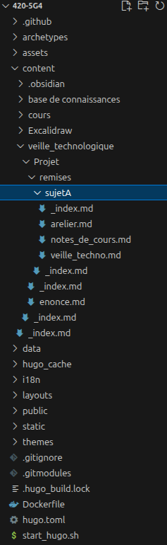

+++
title = "Enoncé"
weight = 1
draft = false

[params]
  menuPre = '<i class="fa-solid fa-scroll"></i> '
+++

## Énoncé

Pour développer les compétences nécessaires à la recherche de nouvelles solutions, la rédaction de notes de cours sur une technologie émergente constitue un excellent exercice pratique. Cette démarche permet de travailler la synthèse d'informations techniques et leur transmission pédagogique.

Vous trouverez [ici](#exemple-de-technologies-a-explorer) une liste de choix possibles, mais vous pouvez choisir le sujet que vous désirez (me contacter avant). Il est possible de faire le travail sur une technologie qui n'est pas émergente, mais que vous n'avez pas vue dans vos cours.

Vous devrez rédiger des notes de cours, écrire un laboratoire pratique et mettre en place une veille technologique.

> Le travail se fait seul ou en équipes de **2 à 3** personnes.

## Évaluation

Ce travail compte pour **40%** de votre session et sera corrigé selon la grille suivante:

|Critère|Pourcentage|
|---|---|
|Veille technologique | **5%** |
|Notes de cours       | **10%**|
|Laboratoire pratique | **10%**|
|Suivi                | **5%** |
|Demo en classe       | **10%**|
|**Total**            | **40%**|

## Étapes de remise

- **Validation du sujet** : validation / définition avec votre professeur, au plus tard à la fin du premier cours sur le projet.
- **Suivi du projet** : au second cours il y aura un suivi pour voir votre avancement sur le projet, si la direction est toujours bonne.
- **Démonstration** : mercredi 9/12 (Gr 3), vendredi 11/12 (Gr 1), mardi 15/12 (Gr 2).
  *Assurez vous d'avoir une version fonctionnel du site pour me montrer pendant la démonstration, même si vous n'avez pas encore terminé votre contribution.*
- **Remise finale** : vous devez faire votre `pull request` au plus tard le **18/12/26 23:59** pour les 3 groupes.

---

## Exemple de technologies à explorer
- **Langages**: Rust, Go, GLSL, WASM...
- **Moteurs de jeux**: Unreal, Godot, unity...
- **live coding**: graphique, musique...
- **IA**: utilisation de llms locaux, les harness, modèle d'IA décisionnel, reverse engineering
- **sujet théorique**: cryptographie, les passkey, blockchain, informatique quantique, techniques de compression, architecture des processeurs... 

---

## Spécifications détaillées

Tout ce travail sera réaliser sur ce site même. 
- Vous allez travailler avec la plateforme `Hugo` qui permet de créer un site web statique grâce à de simple fichier markdown. 
- Vous utiliserez `git` pour récupérer le site existant, contribuer à l'ajout de nouvelles pages avec vos collaborateurs. 
- Vous utiliserez également de `docker` pour tester vos ajouts au site.

> [!warning] Attention
> Assurez vous que votre site est fonctionnel après chaque push. 
> 
> Pour une garantie maximale, clonez votre site dans un nouveau répertoire et connectez vous a votre site en local.

Référez-vous à la section [Méthode de travail](../../base-de-connaissances/methode/) pour une vision plus détaillée.

---

Insérez votre contribution dans la partie [remise](remises) du site : `content->veille_technologique->Projet->remises->VOTRESUJET`. 

Vous pouvez vous inspirer de l'exemple [Sujet A](remises/sujeta) pour les 3 parties de votre projet. 
- Notes de cours
- Atelier
- Veille technologique

Regardez comment est formaté le reste du site si vous souhaitez faire des choses un peu plus avancées (hiérarchie des répertoires, fichiers `index.md` et `_index.md`)

### Veille technologique

Afin de ne pas présenter du matériel désuet à vos étudiants, vous désirez toujours être au courant des nouveautés. Et par où commencer ?

Ici, on va commencer par interroger les outils actuels, les llms, tout en gardant un contrôle éditorial strict.

Commencez par interroger un LLM doté d'un accès web (ou un outil de recherche approfondie / Deep Research) pour cartographier votre sujet. 
> Documentez votre requête initiale, l'outil utilisé (modèle, version, mode actif) et le résultat généré.
> Evitez les prompt du genre *fait moi un cours sur...*

Ensuite, discutez de la réponse : vous semble-t-elle complète ? comment ça se compare à un moteur de recherche ? à un autre llm ? à ce que vous connaissez déjà du sujet ? Avez-vous trouvez une page web qui contient déjà toutes ces informations ou suffisamment proche ? (justifier avec des liens vers des sources et qualité des sources)

Une fois que vous avez établi votre plan de recherche (étendue / profondeur du sujet), 

Vous devez mettre en place une veille technologique sur le sujet que vous avez choisi. Cette veille contiendra, minimalement, les éléments suivants :

- Premiers prompts et réponse avec un llm : (précisez le modèle et la version), et discussion.
- Audit des citations : Ouvrez les sources citées par l'IA. Le modèle résume-t-il fidèlement l'article original ou extrapole-t-il des faits ?
- Comparaison méthodologique : En quoi cette synthèse diffère-t-elle d'une recherche manuelle directe (documentation officielle, dépôts GitHub, moteurs classiques) ou de l'avis d'un second modèle ?
- Source pivot : Avez-vous identifié une ressource de référence (guide officiel, spécification, article de fond, venant du llm ou d'un moteur de recherche) qui reprend la synthèse de l'IA en détail ?
- Le corpus pour les notes de cours : Les sources primaires retenues (documentations, standards, billets d'ingénierie) et les raisons de votre choix.
- quelques sources réseaux sociaux / chaine youtube, pas seulement des relais de produits commerciaux que vous poiuvez consulter poour suivre les avancement de la technologie. L'état de la communauté est un bon indice sur technologie.

### Notes de cours

> [!warning] Utilisation IA
> Possible pour les recherches, mais pas pour la rédaction.

Vous expliquez le sujet choisi comme si vous vous adressiez à des étudiants de cinquième session, donc qui ont un bon bagage en informatique, mais qui ne connaissent pas la technologie que vous avez choisie.

Je m'attends à un minimum de 2000 mots (ce que contient environ la page de cours sur docker), n'allez pas au delà de 5000 mots, sauf si on en a discuté avant, vous devrez choisir les thèmes important à aborder. Avec vos notes, un étudiant devrait être en mesure de comprendre les fondements théoriques de la technologie et d'avoir des exemples de cas d'utilisation.

Faites attention à la clarté de vos propos et au français, utilisez des outils de corrections automatiques si nécessaire.

Il est nécessaire de citer vos sources en fin de page (reprennez le corpus de la veille technologique). 

### Laboratoire

> [!warning] Utilisation IA
> Possible mais pas pour la rédaction.

Vous créez une série d'exercices / démonstration qui permettent d'expérimenter la technologie choisie. Les exercices ne doivent pas être trop compliqués et être réalisables pour un néophyte en 2 à 3 heures. Pour estimer le temps que prendront les étudiants, les professeurs multiplient par 2 à 4 le temps qu'il leur faut pour le faire eux-mêmes. Ainsi, si vous êtes capables de faire le laboratoire en 45 minutes, il faudrait normalement de 1h30 à 3h00 pour quelqu'un qui l'essaie pour une première fois.

Les instructions doivent être claires et inclure l'installation, de préférence, fournissez un dockerfile pour l'atelier. N'hésitez à ajouter des images. Écrivez un laboratoire de la manière que vous auriez aimé que vos professeurs le fassent.

Vous devez inclure un corrigé des exercices.

### Suivi et démo

Lors de la seconde séance, on fera un suivi de l'avancée du projet. Le site web doit être fonctionnel avec le début de vos contributions. La veille technologique devrait être terminée, le cours et l'atelier doivent être également défini (plan, type d'atelier), mais pas forcement terminé.

Vous devrez également faire une démonstration technique de votre projet la dernière semaine. S'il s'agit d'une veille technologique plus théorique, cela prendra la forme d'une présentation.

Dans le cas où le projet est fait en groupe, tous les membres du groupe doivent être en mesure de faire la démo, et être autant capable de répondre aux questions sur le cours ou l'atelier.

Vous pouvez utiliser votre atelier comme base de présentation, mais attention, la démonstration sera beaucoup plus courte, environ 5 minutes avec les questions.

Vous pouvez aussi monter une démonstration plus ambitieuse que votre atelier, mais on doit rester dans les limites de temps.

**La démonstration aura lieu en classe.**

---

## Ressources pour l'utilisation de Hugo
- Documentation Hugo : https://gohugo.io/documentation/
- Documentation Theme Hugo Relearn: https://mcshelby.github.io/hugo-theme-relearn/index.html
- Le Dockerfile pour Hugo v148.1 et Relearn v8 est fourni sur le dépôt du site.
  

  <a href="https://github.com/T-Piquet/420-5G4-projet-A26.git"><i class="fa-brands fa-github"></i> Dépot Github du projet</a> 

## Utilisation du dépôt git

Comme pour le TP C++ nous utiliser un fork pour travailler sur le porjet.

Référez vous à la [page git](../../base-de-connaissances/git/#utilisation-des-forks) pour plus de détails.

> [!warning] Attention
> Ne pas ajouter de **fichiers trop volumineux**. Si vous avez besoin de joindre une vidéo, des données d'entrainement, utilisez des liens vers l'extérieur : *youtube*, *onedrive* etc...

