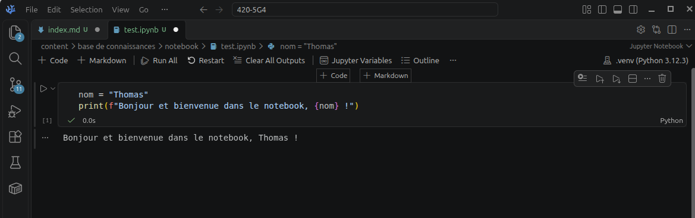
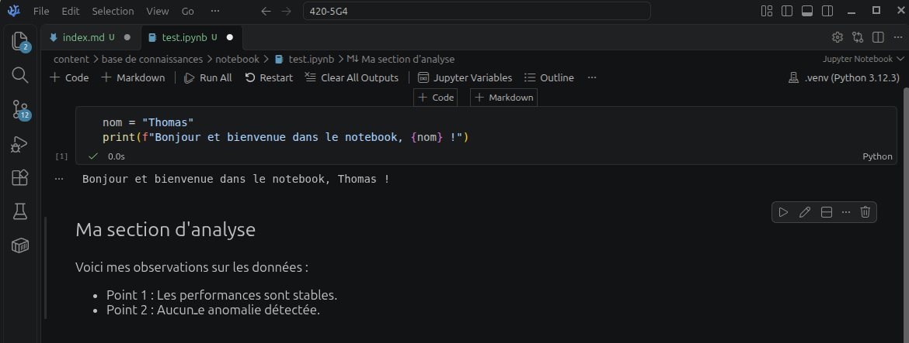
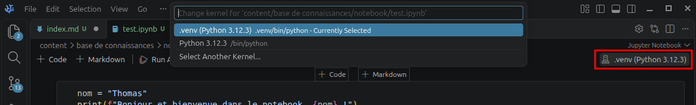

+++
title = "Jupyter Notebook"
weight = 70
+++

## Premiers pas avec les Notebooks Python dans VS Code

Les notebooks (fichiers `.ipynb`) combinent du code exécutable, du texte formaté (Markdown) et des visualisations dans un même document. C'est l'outil idéal pour le prototypage, l'analyse de données et l'enseignement.

### Étape 1 : Installer les extensions indispensables

Pour faire tourner des notebooks, VS Code a besoin de deux extensions principales : l'extension **Python** officielle et l'extension **Jupyter**.

* Ouvrez la vue **Extensions** (raccourci `Ctrl+Shift+X` ou `Cmd+Shift+X`).
* Recherchez et installez **Python** (fourni par Microsoft).
* Recherchez et installez **Jupyter** (fourni par Microsoft).

### Étape 2 : Créer et ouvrir un fichier Notebook

Contrairement aux scripts Python classiques (`.py`), les notebooks utilisent l'extension `.ipynb`.

1. Ouvrez la palette de commandes (`Ctrl+Shift+P` ou `Cmd+Shift+P`).
2. Tapez et sélectionnez : `Jupyter: Create Interactive Window` ou créez simplement un nouveau fichier nommé `mon_cours.ipynb`.
3. VS Code s'ouvre alors sur l'interface du notebook, divisée en **cellules**.

### Étape 3 : Écrire et exécuter votre premier code

Un notebook fonctionne par blocs appelés cellules. Il en existe deux types principaux : **Code** et **Markdown**.

1. Dans la première cellule (de type Code), écrivez une instruction simple :
```python
nom = "Étudiant"
print(f"Bonjour et bienvenue dans le notebook, {nom} !")

```


2. Cliquez sur le bouton **Exécuter** (icône ▶️) ou utilisez le raccourci `Shift + Enter`.
3. Le résultat s'affiche instantanément juste en dessous de la cellule.




### Étape 4 : Utiliser des cellules Markdown pour documenter

L'une des grandes forces des notebooks est de pouvoir intercaler des explications textuelles formatées.

1. Survolez l'espace entre deux cellules ou cliquez sur le bouton `+ Markdown`.
2. Tapez un titre et du texte formaté :
```markdown
### Ma section d'analyse
Voici mes observations sur les données :
- Point 1 : Les performances sont stables.
- Point 2 : Aucunـe anomalie détectée.

```


3. Appuyez sur `Shift + Enter` pour transformer le texte brut en mise en page riche.



### Étape 5 : Sélectionner le bon environnement Python (Kernel)

Pour exécuter votre code, VS Code doit savoir quel environnement virtuel ou interpréteur utiliser.

1. Regardez en haut à droite de l'interface du notebook (ou dans la barre d'état en bas à droite), où le nom de l'environnement Python actuel est affiché.
2. Cliquez dessus pour ouvrir la liste des environnements disponibles et choisissez celui qui contient vos bibliothèques (par exemple, un environnement virtuel ou Anaconda).



> [!info]
> Pour plus de détails : (en anglais)
> 
> [Notebooks dans VScode](https://code.visualstudio.com/docs/datascience/jupyter-notebooks)